# Build Cloud-Native Agentic Apps with UI and Microsoft Foundry Deployable PoC Accelerator

## What is a DPoC?
Deployable PoC Accelerators (DPoC) are packaged Demos using ARM templates and automation scripts (with a demo web application, Power BI reports, Fabric resources like Eventstream, Data Agents, Real Time Dashboards, PySpark notebooks etc.) that can be deployed in a customer’s environment.

## Objective & Intent
Enable partners to easily deploy demos in their own Azure subscriptions and demonstrate them live to their customers.
By partnering with Microsoft sellers, partners can also deploy Industry Scenario Demos into customer subscriptions.
Customers can then get hands-on experience with the demo environment in their own subscription,explore its capabilities, and showcase to their stakeholders.

## Responsible AI Demo Disclaimer
This demonstration is intended to illustrate AI capabilities and may use simulated data, curated prompts, or controlled conditions. The system shown is designed for specific use cases and has known limitations. AI‑generated outputs may be inaccurate, incomplete, biased, or misleading and should be reviewed by a human. This demo does not represent a guarantee of future functionality, performance, or availability, and does not replace human judgment or responsibility.


## Before you begin

1. Read the applicable license and disclaimer in this repository before using or deploying the UI demo.
2. Deployment creates resources in your Azure subscription. **You are responsible for all Azure** Review the resources deployed and remove them when they are no longer needed.
3. This demo is intended for evaluation and demonstration, not production use. Review security and access controls before deployment, and do not use sensitive or production data.
4. For questions or comments, email **[mdxazuredemos@microsoft.com](mailto:mdxazuredemos@microsoft.com).**

## Prerequisites

**Access and roles**

- An Azure account with permission to deploy the resources required by this UI demo.
- **Owner** access on the Azure subscription used for deployment.
- Use the same work or school account to sign in to Azure for the deployment.
- Users must have the Power Platform Administrator role.
- Power Platform environment must be created in the Power Platform Admin Center, with billing enabled.
- Users should have global admin role.
 

**Licenses**

- To access the agent in **Microsoft 365 Copilot**, each user needs a supported Microsoft 365 base license and a Microsoft 365 Copilot license. Confirm current licensing requirements for your tenant.
- Below license are required:
    - GitHub Enterprise Cloud, 
    - GitHub Copilot Enterprise (or Business)
    - Microsoft 365 Copilot
    - Microsoft Copilot Studio User License
    - Microsoft Copilot Studio
    - Agent 365
    - Microsoft Defender for Endpoint P2
    - Microsoft 365 E5
    - Microsoft Copilot Studio (User License + Copilot Credits capacity or pay-as-you-go)
- In the Microsoft 365 admin center, assign these licenses to the target user: **Copilot Studio Viral Trial**, **Power Apps for Developer**, and **Power Automate Free**. Go to **Users → Active users → Licenses and apps**. Before assigning licenses, make sure the user's **Usage location** is set to a two-letter country or region code in Microsoft Entra ID. This setting is required to determine service availability, and license assignment may fail if it is missing. An administrator can set it in the Microsoft 365 admin center under **Users → Active users → [user] → Manage contact information → Usage location**. Users cannot set their own usage location.    

**Azure resources**

- Your Azure subscription must allow creation of the resources required by the deployment script, including:
  - Azure resource group
  - Azure Storage account and blob container
  - Azure AI Services / Azure AI Foundry account (hub)
  - Azure AI Foundry project
  - Azure AI Search service
  - Azure OpenAI model deployments (for example, `gpt-5.5` and `text-embedding-3-large`)
- Ensure the following resource providers are available in the target subscription:
  - Microsoft.Storage
  - Microsoft.CognitiveServices
  - Microsoft.Search
- Select a region where all required services and SKUs are available. The deployment creates Azure AI resources and model deployments, and the script can fail if the selected region does not support the required Azure OpenAI and AI Search offerings. See [Azure Services Global Availability](https://azure.microsoft.com/en-us/global-infrastructure/services/?products=all).

**Copilot Studio (only if you build or publish agents there)**

- **System Administrator** access in **Copilot Studio** to build and manage copilots, including creating agents, connecting data, and publishing them. A separate environment should also be created in Copilot Studio.
- A Power Platform admin must enable **Dataverse** in that Copilot Studio environment and set up the billing plan in the Power Platform Admin Center. On new tenants, confirm billing is configured before creating and publishing agents.

## Tenant settings to enable

Before running the deployment script, confirm that your tenant allows the required Azure OpenAI and AI services for the deployment and that your organization's required preview settings are enabled as appropriate.

> **Note:** Allow up to 15 minutes for tenant setting changes to take effect.

## Notes

- You must only execute one deployment at a time and wait for its completion. Running multiple deployments simultaneously is highly discouraged, as it can lead to deployment failures.
- In this Accelerator, we have converted real-time reports into static reports for the user's ease but have covered the entire process to configure real-time datasets. Using those real-time datasets, you can create real-time reports.
- Review the [License Agreement](https://dev.azure.com/Cloud-AI-Demo-Delivery/Cloud%20and%20AI%20Demo%20Delivery/_git/Dpoc?path=/license.md) before proceeding.

## Contents
- [Task 1: Run the Cloud Shell to provision the demo resources](#task-1-run-the-cloud-shell-to-provision-the-demo-resources)
- [After the deployment completes](#after-the-deployment-completes)

### Task 1: Run the Cloud Shell to provision the demo resources

> **Note:** In this task, we will execute a PowerShell script on CloudShell to deploy assets.

> **Note:** The list of resources is as follows:

**Azure resources:**

| Name | Type |
| :--- | :--- |
| rg-ui-<$suffix> | Microsoft.Resources/resourceGroups |
| storage<$suffix> | Microsoft.Storage/storageAccounts |
| hub-aifoundry-ui-<$suffix> | Microsoft.CognitiveServices/accounts |
| hub-aifoundry-ui-<$suffix> / proj-aifoundry-ui-<$suffix> | Microsoft.CognitiveServices/accounts/projects |
| srch-ui-<$suffix> | Microsoft.Search/searchServices |
| enterprise-knowledgebase | Microsoft.Storage/storageAccounts/blobServices/containers |

---

1. **Open** the Azure Portal by clicking on the button below:

   <a href='https://portal.azure.com/' target='_blank'></a>

   > **Note:** If prompted, use your Azure Active Directory credentials to login to Azure.

2. In the Azure portal, select the **Terminal icon** to open Azure Cloud Shell.

   

3. **Click** on **PowerShell**.

   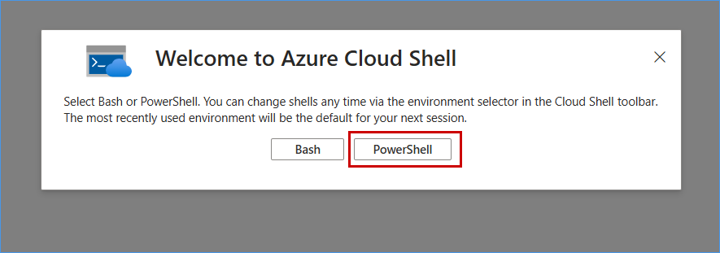

4. Select the **Subscription** and click on **Apply**.

   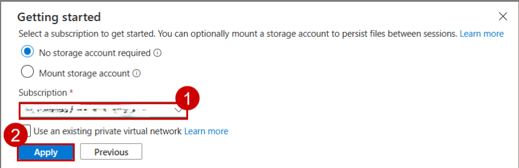

   > **Note:** If you already have a storage mounted for Cloud Shell, you will not get this prompt.

5. In the Azure Cloud Shell window, ensure that the **PowerShell** environment is selected.

   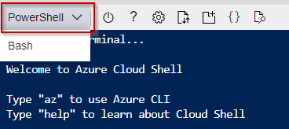

6. **Expand** the Cloudshell window.

   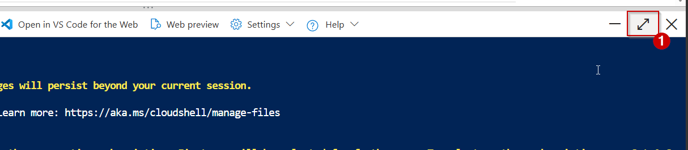

   > **Note:** All the cmdlets used in the script work best in PowerShell.

   > **Note:** Use **Ctrl+C** to copy and **Shift+Insert** to paste, as **Ctrl+V** is NOT supported by Cloud Shell.

7. Enter the following **command** to clone the repository files in Cloud Shell.

   Command:

   ```
   git clone -b ui_dpoc --depth 1 --single-branch https://github.com/microsoft/Azure-Analytics-and-AI-Engagement.git ui
   ```

   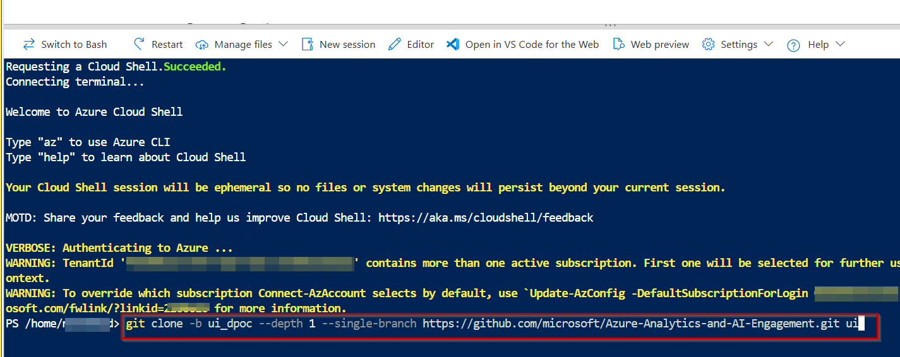

   > **Note:** If you get **File already exists.** error, please execute the following command to delete existing clone and then re-clone:
   ```
   rm ui -r -f
   ```

   > **Note:** When executing scripts, it is important to let them run to completion. Some tasks may take longer than others to run. When a script completes execution, you will be returned to a command prompt.

8. **Execute** the PowerShell script with the following command:

   ```
   cd ./ui/ui
   ```

   ```
   ./uiSetup.ps1
   ```

   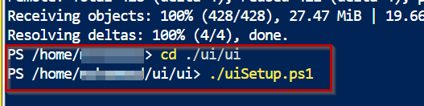

9. **Press** **Y** and click on the **Enter** button.

    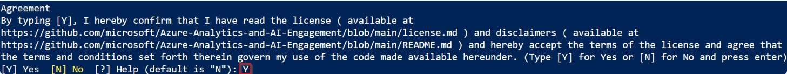

10. From the Azure Cloud Shell, **copy** the authentication code. You will need to enter the code in the next step.

11. **Click** on the link https://microsoft.com/devicelogin and a new browser window will launch.

    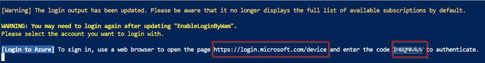

12. **Paste** the authentication code and click on the **Next** button.

    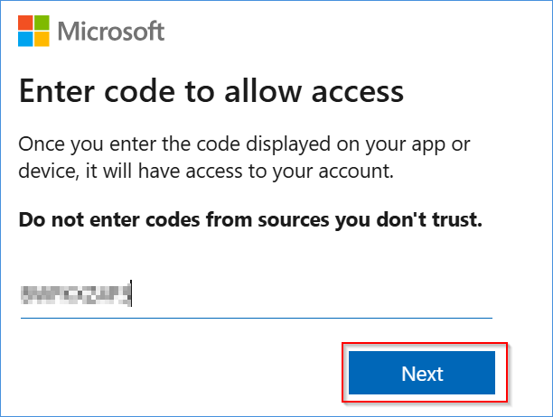

13. **Select** the user account you used for logging into the Azure Portal in [Task 1](#task-1-run-the-cloud-shell-to-provision-the-demo-resources).

    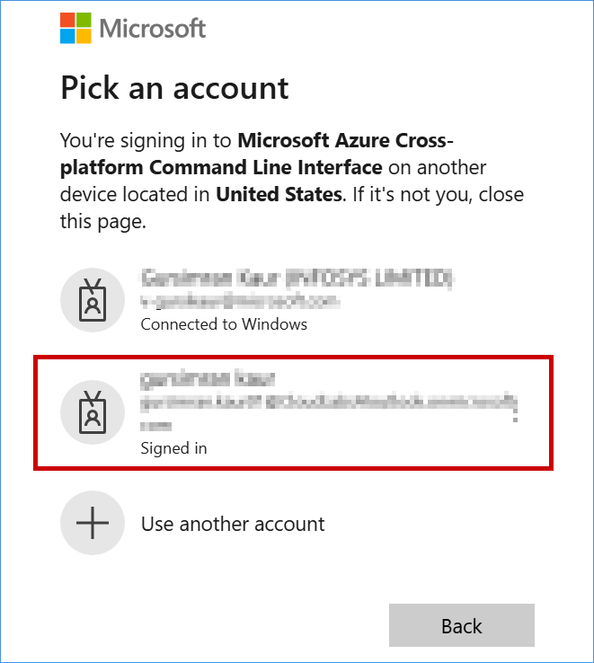

14. **Click** on the **Continue** button.

    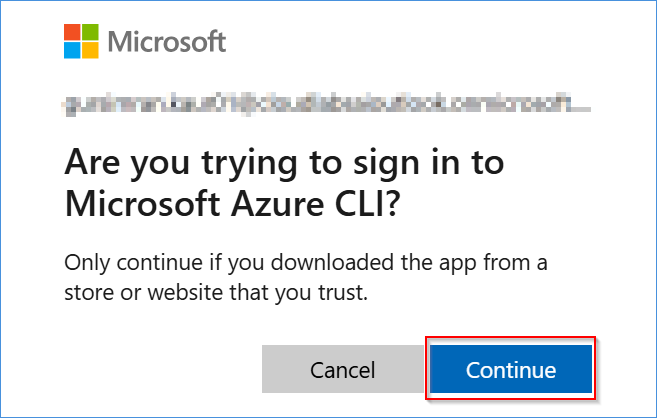

15. **Close** the browser tab when you see the message box.

    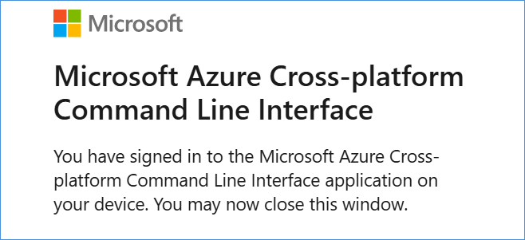

16. **Navigate back** to your **Azure Cloud Shell** execution window.

17. **Enter** the number on the left side of your subscription name from the screen and press **Enter** key.

    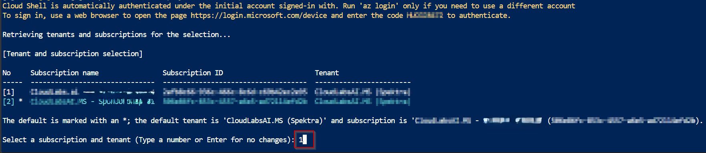

    > **Notes:**
    > - Users with a single subscription won't be prompted to select a subscription.
    > - The subscription highlighted in Light blue will be selected by default, if you do not enter a desired subscription. Please select the subscription carefully as it may break the execution further.
    > - While you are waiting for the processes to complete in the Azure Cloud Shell window, you'll be asked to enter the code three times. This is necessary for performing the installation of various Azure Services and preloading the data.

18. **Copy** the code on the screen to authenticate the **Azure PowerShell script** for creating the resources. **Click** the link https://microsoft.com/devicelogin.

    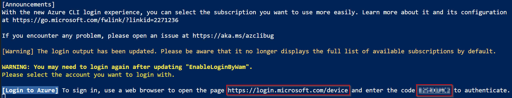

19. A new browser window will launch. **Paste** the **authentication code** you copied from the shell above and press **Enter**.

    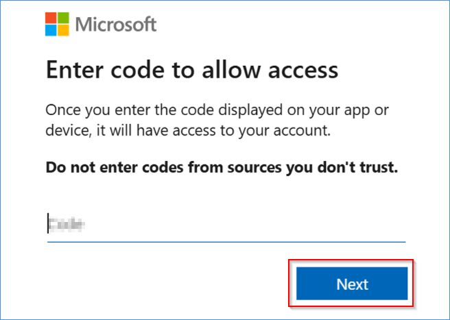

20. **Select** the user account that is used for logging into the Azure Portal in [Task 1](#task-1-run-the-cloud-shell-to-provision-the-demo-resources).

    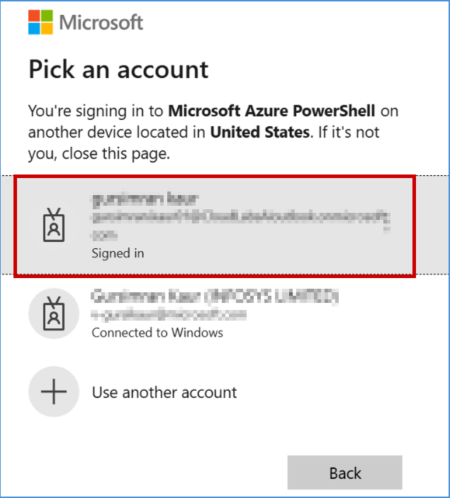

21. Click on **Continue**.

    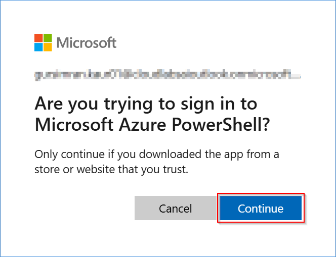

22. **Close** the browser tab when you see the message box.

    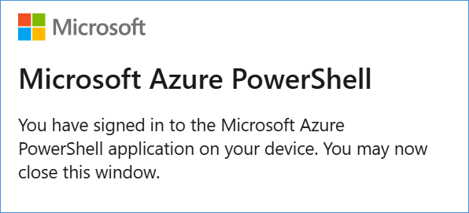

23. Go back to the **Azure Cloud Shell** execution window.

24. **Enter** the Region for deployment with the necessary resources available, preferably "northcentralus".
    (Ex.: eastus2,eastus westus, westus2, etc.)

    

    > **Note:** During the execution of the script, you might see outputs and warnings displayed in red color in between while text outputs.
    > Do not treat every red message as an error. Focus on the outputs and only consider them as errors only if it explicitly indicates an error.
    > An example is provided below showing a warning:

    > Example

    

25. A screen similar to the screenshot below indicates the end of your script execution.

    

### Post-Deployment Steps

> **Note:** Complete this once Task 1 has finished successfully.

1. **Assign** the required Storage Blob Data Owner role.

   - Ensure that your Entra ID user has the **Storage Blob Data Owner** role assigned on the storage account whose name starts with **storage**.

2. **Assign** the required Azure AI access role for the demo environment.

   - Assign the **Foundry User** role to the user who needs access to Azure AI Foundry. Assign it at the Azure AI Foundry project scope.

3. **Assign** the same permissions to the testing user.

   - If the user deploying the demo and the user testing it are different, ensure the testing user has the same permissions as the deploying user so they can view all resources, including Foundry agents.